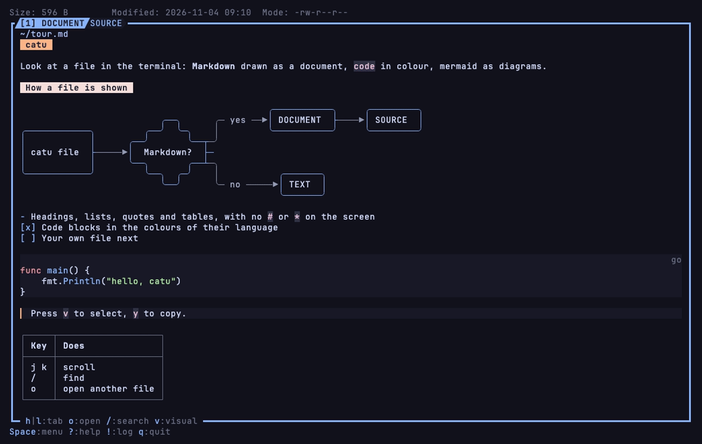

# catu

[](https://github.com/vulcanshen/catu/releases)
[](LICENSE)

**Language**: [English](README.md) · 繁體中文

**終端機裡看檔案的工具：Markdown 畫成文件、mermaid 畫成圖，其他檔案照它的顏色。**

`catu <檔案>` 把一個檔案放在一個 panel 裡，用 vim 的鍵捲動、找字、複製。Markdown 畫成文件 —— 標題、清單、程式碼、
引用、表格，畫面上沒有 `#`、`*` —— 裡面的 mermaid 區塊畫成圖；按 `l` 看原始碼。程式碼照語言上色、附行號。目錄、
壓縮檔、PDF、圖片、二進位檔，照 terminu 家族預覽檔案的方式顯示。



## 特色

- **Markdown 畫成文件**：標題鋪上它那一層的顏色、清單、照語言上色的程式碼區塊、引用、畫成格子的表格、連結與圖片前面有
  icon；原始碼一個鍵就到。
- **終端機裡的 mermaid 圖**：flowchart、sequence、state、class 等圖用線與框畫出來，由
  [Pele](https://github.com/obsidianmd/pele) 照 panel 的寬度排；panel 窄的時候，由左往右的圖改成由上往下。Markdown 的
  `mermaid` 區塊與 `.mmd` 檔都畫，不必另外裝任何東西。
- **每個檔案都有顏色**：程式碼有語法顏色與行號；長的行折到下一列，什麼都不會被截掉。
- **每一種檔案**：目錄與壓縮檔畫成樹、PDF 的文字、圖片的 data URI、二進位檔的十六進位。
- **vim 的鍵**：`j|k`、`u|d`、`gg|G` 捲動；`v` 叫出游標，用 `h|j|k|l`、`w|b|e`、`0|$` 移動，`y` 複製選起來的字。
  `/` 找字，`n|N` 一個一個看。
- **不用離開就能看別的檔案**：`o` 打開附預覽的檔案選擇器。

## 安裝

### 需求

- macOS 或 Linux（WSL 也可以）。
- 終端機的設定檔用 [Nerd Font](https://www.nerdfonts.com)：icon 與框線都是 Nerd Font 的字。
- 支援 truecolor（24 位元色）的終端機：淡化的顏色與 popup 的層色，在 256 色下分不出來。
- 終端機至少 40 欄寬、12 列高；更小的時候 catu 只畫它的名字、需要多大、怎麼離開，終端機拉大就回到原本的樣子。

catu 啟動時會量 icon 與 powerline 符號佔幾格。量錯的時候自己設：

| 變數 | 設的是 |
|---|---|
| `CATU__ICON_WIDTH` | icon 佔幾格，只給 catu |
| `CATU__POWERLINE_WIDTH` | powerline 符號佔幾格，只給 catu |
| `TERMINU__ICON_WIDTH` | icon 佔幾格，給 terminu 家族每一個 app：設一次，全部都讀得到 |
| `TERMINU__POWERLINE_WIDTH` | powerline 符號佔幾格，給 terminu 家族每一個 app |
| `LC_TERMINU_ICON_WIDTH` | icon 佔幾格，由有 ssh 的家族 app 帶過 ssh |
| `LC_TERMINU_POWERLINE_WIDTH` | powerline 符號佔幾格，由有 ssh 的家族 app 帶過 ssh |

icon 與 powerline 符號各自照表上的順序，取第一個有設的；都沒設才量。在家族 app 的終端機裡跑時，外層的 app 會替 catu
設好 `TERMINU__` 的兩個；從家族 app 經 ssh 連過來時，是 `LC_TERMINU_` 的兩個。

### Homebrew

```sh
brew install vulcanshen/tap/catu
```

### 安裝腳本

```sh
curl -fsSL https://raw.githubusercontent.com/vulcanshen/catu/main/install.sh | sh
```

不用 sudo：裝在 `~/.local/bin`。

### Go

```sh
go install github.com/vulcanshen/catu/cmd/catu@latest
```

### 第一次啟動

`catu README.md` 打開那個檔案；只打 `catu` 是看目前的目錄。catu 不寫任何東西：它只讀你給它的檔案，以及你寫了的
設定。

### 移除

```sh
brew uninstall catu
```

用安裝腳本裝的：

```sh
curl -fsSL https://raw.githubusercontent.com/vulcanshen/catu/main/uninstall.sh | sh
```

## 快速開始

1. 執行 `catu README.md`。
2. 按 `j`、`k` 捲動，`d`、`u` 捲半頁，`gg`、`G` 到最上面、最下面。
3. 按 `l` 看 Markdown 的原始碼，按 `h` 回到文件。
4. 按 `/`，打一個字再按 `Enter`；`n`、`N` 到下一個、上一個找到的地方。
5. 按 `o` 打開別的檔案，按 `q` 離開。

## 使用方式

```
catu [路徑]       看一個檔案或目錄（沒給就是目前的目錄）
catu -p [路徑]    不開畫面，帶顏色印出來就結束（--print）
catu version      印出版本（-v、--version）
catu help         印出命令列的用法（-h、--help）
```

路徑不存在、或沒有權限讀的時候，像 `cat` 一樣在命令列說出來。檔名剛好叫 `version` 或 `help`：`catu ./version`。

輸出不是終端機時，catu 不開畫面，改成印出來、不帶顏色：文字檔一個 byte 不改照原樣印，跟 `cat` 一樣；Markdown 與 mermaid
印成畫好的文字，寬度是 `$COLUMNS`（沒設就是 80）。所以 `catu flow.mmd > flow.txt` 把圖轉成文字，`catu README.md | less`
一頁一頁看文件。

家族每個 app 都一樣的鍵：

| 鍵 | 做什麼 |
|---|---|
| `Space` | 這裡能做的事，以及整個 app 的 |
| `?` | 這裡每一個能按的鍵 |
| `!` | App Log：做過的事，最新的在最下面；在這裡是打開過的檔案、畫不出來的圖 |
| `j\|k`、`u\|d`、`gg\|G` | 捲一列、半頁、到最上面或最下面 |
| `h\|l` | 切 tab：Markdown 的 `DOCUMENT` 與 `SOURCE`、mermaid 檔的 `DIAGRAM` 與 `SOURCE`、JSON 的 `TEXT` 與 `FORMATTED` |
| `v`、`y` | `v` 再移到要開始的地方，再按 `v` 移動選取；`y` 複製 |
| `Esc` | 一次關掉最上面的一個 popup，或清掉找到的字；永遠不會離開 catu |
| `q` | 離開 |

catu 自己的：

| 鍵 | 做什麼 |
|---|---|
| `o` | 打開別的檔案：在正在看的檔案的目錄打開檔案選擇器 |
| `/` | 找字：每一個找到的地方都加底線 |
| `n`、`N` | 下一個、上一個找到的地方 |

在 Visual 裡（`v`）：`h|j|k|l` 移動游標，`w|b|e` 一個字一個字移，`0|$` 到行首、行尾，`u|d` 與 `gg|G` 跟捲動時一樣。

### 每一種檔案長什麼樣子

| 檔案 | tab | 顯示成 |
|---|---|---|
| Markdown（`.md`、`.markdown`） | `DOCUMENT`、`SOURCE` | 文件；`mermaid` 區塊畫成圖 |
| Mermaid（`.mmd`、`.mermaid`） | `DIAGRAM`、`SOURCE` | 圖 |
| JSON（`.json`） | `TEXT`、`FORMATTED` | 原檔；排過版的縮排 2 格，key 照原本的順序 |
| 其他文字檔 | `TEXT` | 語法顏色與行號 |
| 目錄 | `DIRECTORY` | 三層的樹，不列隱藏檔 |
| 壓縮檔（zip、tar、tar.gz、tar.bz2） | `ARCHIVE` | 裡面有什麼，畫成樹 |
| PDF | `PDF` | 頁數，接著前 20 頁的文字 |
| 圖片 | `IMAGE` | data URI |
| 其他 | `BINARY` | 十六進位，一列 8 bytes |

## 設定與資料

catu 不存資料、狀態、快取。設定是 `$XDG_CONFIG_HOME/catu`（或 `~/.config/catu`；`CATU__CONFIG` 可以指到別的目錄）
裡的 `config.yaml`。catu 不寫它；沒有這個檔就用預設值。

```yaml
input_tab_width: 4               # 文字裡的 Tab 畫成幾格空白
hide_secrets_in_preview: false   # true：私鑰只露第一行，只有你能讀的檔一行都不露
```

兩個都是 terminu 家族每個 app 共用的 key。讀不了的 `config.yaml`，catu 會問要不要把它移到 `config.yaml.bak`，不要就離開。

## 限制

- catu 只看檔案，不改檔案。
- 文字檔只畫前 16 MB，二進位檔只畫前 1 MB。
- 圖片畫成它的 data URI，不是圖：終端機的圖片協定不是每個終端機都有，也放不進一格一格的排版。
- 比 panel 寬的圖從右邊切掉，結尾畫 `…`；pele 讀不懂的圖畫成原始碼，下面寫原因。
- 圖只用框線畫，不用點點：圖形只有外框，不會填滿；曲線畫成直角的轉折，圓畫成兩邊有 `(`、`)` 的框，圓餅圖畫成一條分色的橫條，下面標每個顏色的百分比與代表什麼。
- 只有 macOS 與 Linux（WSL 也可以）；沒有 Windows 版。

## 相關連結

- [CHANGELOG](CHANGELOG.md)
- [Pele](https://github.com/obsidianmd/pele)：排 mermaid 圖（MIT，[它的授權](internal/mermaid/pele/LICENSE)）

## terminu family

catu 遵循 terminu design：

- [terminu design](https://github.com/vulcanshen/terminu)：家族的設計規範
- [terminu-go](https://github.com/vulcanshen/terminu-go)：catu 用來做成的 Go 函式庫
- [terminu-harness](https://github.com/vulcanshen/terminu-harness)：照 terminu design 做 app 的 Claude Code plugin

## License

[GPL-3.0](LICENSE)
