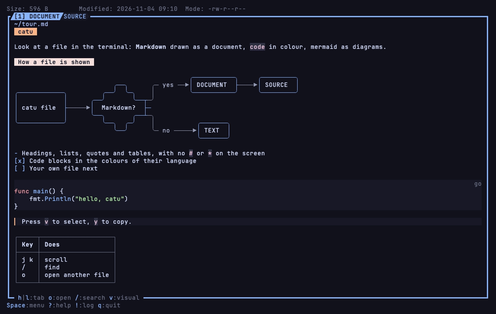

# catu

[](https://github.com/vulcanshen/catu/releases)
[](LICENSE)

**Language**: English · [繁體中文](README-zh_TW.md)

**A file viewer for the terminal: Markdown drawn as a document, mermaid as diagrams, any other file in colour.**

`catu <file>` shows a file in a panel you can scroll, search and copy from with vim's keys. A Markdown file is drawn as a
document — headings, lists, code, quotes and tables, with no `#` or `*` on the screen — and its mermaid blocks as
diagrams; switch to its source with `l`. A source file is in the colours of its language, with line numbers. A directory,
an archive, a PDF, an image or a binary is shown the way the terminu family previews files.



## Features

- **Markdown as a document**: headings on the colour of their level, lists, code blocks in their language's colours,
  quotes, tables drawn as grids, links and images with their icons; its source one key away.
- **Mermaid diagrams in the terminal**: flowcharts, sequence, state, class diagrams and the rest drawn with lines and
  boxes, laid out by [Pele](https://github.com/obsidianmd/pele) to fit the panel; a narrow panel turns a left-to-right
  chart top-down. Works in a `mermaid` code block and in a `.mmd` file, with nothing else to install.
- **Every file in colour**: source code with its syntax colours and line numbers; long lines fold, nothing is cut off.
- **Every kind of file**: a directory or an archive as a tree, a PDF's text, an image as a data URI, a binary in hex.
- **vim's keys**: `j|k`, `u|d`, `gg|G` scroll; `v` brings out a cursor that moves with `h|j|k|l`, `w|b|e`, `0|$`, and
  `y` copies what you select. `/` finds text, `n|N` go through it.
- **Open another file** without leaving: `o` opens a file picker with a preview.
- **On the command line, as `cat` is**: `git log | catu` shows what comes down a pipe; `catu a.go b.md` lists several
  files beside the one shown; `catu -p`, or catu printing into another program, prints a file instead of opening the
  screen, a Markdown file and a diagram drawn.

## Install

### Requirements

- macOS or Linux (WSL too).
- A [Nerd Font](https://www.nerdfonts.com) terminal profile: the icons and the frames are Nerd Font glyphs.
- A truecolor (24-bit) terminal: the faded colours and the layer colours cannot be told apart in 256 colours.
- A terminal at least 40 columns wide and 12 rows high; in a smaller one catu shows only its name, the size it needs and
  how to quit, and comes back as it was once the terminal grows.

catu measures how many cells an icon and a powerline symbol take when it starts. When it gets them wrong, set them:

| Variable | What it sets |
|---|---|
| `CATU__ICON_WIDTH` | The cells an icon takes, for catu |
| `CATU__POWERLINE_WIDTH` | The cells a powerline symbol takes, for catu |
| `TERMINU__ICON_WIDTH` | The cells an icon takes, for every terminu family app: set it once and they all read it |
| `TERMINU__POWERLINE_WIDTH` | The cells a powerline symbol takes, for every terminu family app |
| `LC_TERMINU_ICON_WIDTH` | The cells an icon takes, brought over ssh by a family app with ssh |
| `LC_TERMINU_POWERLINE_WIDTH` | The cells a powerline symbol takes, brought over ssh by a family app with ssh |

For an icon and for a powerline symbol each, catu takes the first one set in the order of the table, and measures only
when none is. Run inside a family app's terminal, catu gets the `TERMINU__` ones from the app around it; reached over
ssh from one, the `LC_TERMINU_` ones.

### Homebrew

```sh
brew install vulcanshen/tap/catu
```

### Script

```sh
curl -fsSL https://raw.githubusercontent.com/vulcanshen/catu/main/install.sh | sh
```

No sudo: it installs to `~/.local/bin`.

### Go

```sh
go install github.com/vulcanshen/catu/cmd/catu@latest
```

### The first start

`catu README.md` opens the file; `catu` alone shows the current directory. catu writes nothing anywhere: it only reads
the file you give it and its settings, when you have made some.

### Uninstall

```sh
brew uninstall catu
```

Installed with the script:

```sh
curl -fsSL https://raw.githubusercontent.com/vulcanshen/catu/main/uninstall.sh | sh
```

## Quick start

1. Run `catu README.md`.
2. Press `j` and `k` to scroll, `d` and `u` for half a page, `gg` and `G` for the top and the bottom.
3. Press `l` for the Markdown's source, `h` to come back to the document.
4. Press `/`, type a word and `Enter`; `n` and `N` go to the next and the previous place it is.
5. Press `o` to open another file, `q` to quit.

## Usage

```
catu [path...]        look at a file or a directory (the current directory when left out); two or
                      more are listed in a FILES panel beside the one shown
cmd | catu [-l fmt]   look at what comes down a pipe (also catu -)
catu -p [path...]     print them instead, in colour, and quit (--print)
catu version          print the version (-v, --version)
catu help             print the command-line usage (-h, --help)
```

What comes down a pipe is a plain text unless `-l` (`--lang`) names its format: `md`, `mermaid`, `json`, or a language
by its name or its extension, as `git diff | catu -l diff` or `curl -s https://… | catu -l md`.

A path that is not there, or that you may not read, is said on the command line, as `cat` says it. A file named `version`
or `help`: `catu ./version`.

When its output is not a terminal, catu prints instead of opening its screen, with no colours: a text file byte for byte,
as `cat` does, and a Markdown file or a mermaid diagram drawn, `$COLUMNS` wide (80 when it is not set). So
`catu flow.mmd > flow.txt` turns a diagram into text, and `catu README.md | less` pages a document.

The keys every family app shares:

| Key | What it does |
|---|---|
| `Space` | What you can do here, and for the whole app |
| `Tab`, `1\|2` | With several files: move between the `FILES` list and the file shown; `Enter` on the list goes to the file |
| `?` | Every key that works here |
| `!` | The App Log: what was done, newest last; here, the files opened and the diagrams that could not be drawn |
| `j\|k`, `u\|d`, `gg\|G` | Scroll a row, half a page, to the top or the bottom |
| `h\|l` | Switch tabs: a Markdown file's `DOCUMENT` and `SOURCE`, a mermaid file's `DIAGRAM` and `SOURCE`, a JSON file's `TEXT` and `FORMATTED` |
| `v`, `y` | `v` and move to where to start, `v` again and move to select; `y` copies it |
| `Esc` | Close the popup on top, one at a time, or clear what a search found; it never leaves catu |
| `q` | Quit |

catu's own:

| Key | What it does |
|---|---|
| `o` | Open another file: a file picker in the directory of the one shown; with several files, it joins the list |
| `/` | Find text: every place it is is underlined |
| `n`, `N` | The next and the previous place found |

In the Visual mode (`v`): `h|j|k|l` move the cursor, `w|b|e` by words, `0|$` to the start and the end of the line, `u|d`
and `gg|G` as when scrolling.

### What each kind of file looks like

| File | Tabs | Shown as |
|---|---|---|
| Markdown (`.md`, `.markdown`) | `DOCUMENT`, `SOURCE` | A document; its `mermaid` blocks as diagrams |
| Mermaid (`.mmd`, `.mermaid`) | `DIAGRAM`, `SOURCE` | The diagram |
| JSON (`.json`) | `TEXT`, `FORMATTED` | The file as it is; formatted, two spaces an indent, its keys in their order |
| Any other text | `TEXT` | Its syntax colours and line numbers |
| A directory | `DIRECTORY` | A tree three levels deep, hidden files left out |
| An archive (zip, tar, tar.gz, tar.bz2) | `ARCHIVE` | What it holds, as a tree |
| A PDF | `PDF` | The page count, then the text of the first 20 pages |
| An image | `IMAGE` | A data URI |
| Anything else | `BINARY` | Hex, eight bytes a row |

## Settings and data

catu keeps no data, no state and no cache. Its settings are `config.yaml` in `$XDG_CONFIG_HOME/catu` (or
`~/.config/catu`; `CATU__CONFIG` names another directory). catu never writes it; with no file, it uses the defaults.

```yaml
input_tab_width: 4               # the spaces a tab in a text is drawn as
hide_secrets_in_preview: false   # true: a private key shows its first line only, a file only you may read shows nothing
```

Both are keys every terminu family app shares. A `config.yaml` catu cannot read is offered to be moved aside to
`config.yaml.bak`, or catu quits. When catu prints, with no screen to ask on, it stops instead: nothing is printed, and
it says which file and why.

What comes down a pipe is put in a file in the system's temp directory (`$TMPDIR`) while catu looks at it, and removed
when catu quits.

## Limits

- catu only shows files; it does not edit them.
- A text's first 16 MB is shown, a binary's first 1 MB.
- Images are shown as their data URI, not as pictures: a terminal's picture protocols are not in every terminal and do not
  fit its rows of cells.
- A diagram wider than the panel is cut at its right edge, with a `…`; one pele cannot read is shown as its source with
  the reason under it.
- Diagrams are drawn with box-drawing lines, never dots: shapes are outlined, not filled; a curve turns at right angles,
  a circle is a box with `(` and `)` on its sides, and a pie chart is drawn as one bar in its slices' colours, each
  colour's share and name under it.
- macOS and Linux only (WSL too); there is no Windows build.

## Links

- [CHANGELOG](CHANGELOG.md)
- [Pele](https://github.com/obsidianmd/pele): lays out the mermaid diagrams (MIT, [its license](internal/mermaid/pele/LICENSE))

## The terminu family

catu follows terminu design:

- [terminu design](https://github.com/vulcanshen/terminu): the family's design rules
- [terminu-go](https://github.com/vulcanshen/terminu-go): the Go library catu is built with
- [terminu-harness](https://github.com/vulcanshen/terminu-harness): the Claude Code plugin for building apps to terminu
  design

## License

[GPL-3.0](LICENSE)
